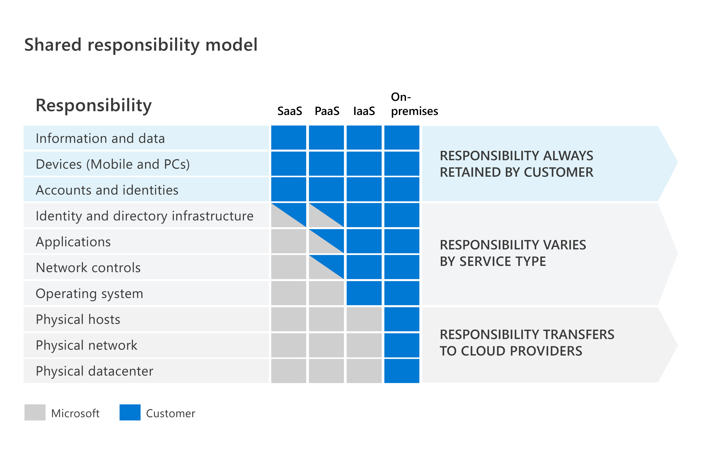
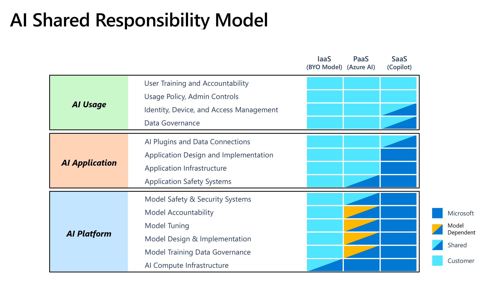

study guide: https://learn.microsoft.com/en-us/credentials/certifications/resources/study-guides/sc-900 
Free practice exam: https://learn.microsoft.com/en-us/credentials/certifications/resources/study-guides/sc-900 
Self-pace learning: https://learn.microsoft.com/en-us/credentials/certifications/resources/study-guides/sc-900 

## Shared responsibility in the cloud

**On-premises:** your organization owns every layer. That includes the building, hardware, network devices, operating systems, applications, identities, and data. You get full control, but you also carry the full security burden.

**Cloud:** some security work moves to the cloud provider. How much depends on the service model.

| Model | Cloud provider secures | You secure |
|---|---|---|
| **On-premises** | Nothing | Everything: building, hardware, OS, apps, data |
| **IaaS** (Infrastructure as a Service) | Physical datacenter, network hardware, host machines | OS, applications, network controls you configure, data |
| **PaaS** (Platform as a Service) | All of IaaS **+** OS and runtime | Application code and its configuration, access controls, data |
| **SaaS** (Software as a Service) | The entire application stack and infrastructure | Access management (who uses it), data, tenant-level settings |

> **Key takeaway:** going from on-prem → IaaS → PaaS → SaaS, the provider takes on more of the stack. In every model, **your data, devices, and accounts/identities stay your responsibility**.

### Shared responsibility model: layer by layer

**You** = customer · **Microsoft** = cloud provider · **Shared** = split between both

| Responsibility | SaaS | PaaS | IaaS | On-prem |
|---|---|---|---|---|
| ***Always retained by customer*** | | | | |
| Information and data | You | You | You | You |
| Devices (mobile and PCs) | You | You | You | You |
| Accounts and identities | You | You | You | You |
| ***Varies by service type*** | | | | |
| Identity and directory infrastructure | Shared | Shared | You | You |
| Applications | Microsoft | Shared | You | You |
| Network controls | Microsoft | Shared | You | You |
| Operating system | Microsoft | Microsoft | You | You |
| ***Transfers to cloud provider*** | | | | |
| Physical hosts | Microsoft | Microsoft | Microsoft | You |
| Physical network | Microsoft | Microsoft | Microsoft | You |
| Physical datacenter | Microsoft | Microsoft | Microsoft | You |

**How to remember it:**
- **Top 3 rows** (data, devices, accounts): always yours, even in SaaS.
- **Middle 4 rows**: the split depends on the model. IaaS leaves them all with you. PaaS shares identity, apps, and network controls. SaaS hands everything except identity infrastructure to Microsoft.
- **Bottom 3 rows** (physical hosts, network, datacenter): the provider owns them in every cloud model. You only handle them on-premises.

### AI shared responsibility model

The same idea applies to AI services, organized into three layers: **AI usage**, **AI application**, and **AI platform**.

- **IaaS** = bring your own model (BYO model)
- **PaaS** = Azure AI
- **SaaS** = Copilot

**You** = customer · **Microsoft** = cloud provider · **Shared** = split between both · **Model dependent** = varies depending on which model you use

| Responsibility | IaaS (BYO model) | PaaS (Azure AI) | SaaS (Copilot) |
|---|---|---|---|
| ***AI usage*** | | | |
| User training and accountability | You | You | You |
| Usage policy, admin controls | You | You | You |
| Identity, device, and access management | You | You | Shared |
| Data governance | You | You | Shared |
| ***AI application*** | | | |
| AI plugins and data connections | You | You | Shared |
| Application design and implementation | You | You | Microsoft |
| Application infrastructure | You | You | Microsoft |
| Application safety systems | You | Shared | Microsoft |
| ***AI platform*** | | | |
| Model safety and security systems | You | Shared | Microsoft |
| Model accountability | You | Model dependent | Microsoft |
| Model tuning | You | Model dependent | Microsoft |
| Model design and implementation | You | Model dependent | Microsoft |
| Model training data governance | You | Model dependent | Microsoft |
| AI compute infrastructure | Shared | Microsoft | Microsoft |

**How to remember it:**
- **AI usage** (top): mostly yours in every model. User training and usage policy are **always** yours, even with Copilot.
- **AI application** (middle): yours in IaaS and PaaS. With Copilot (SaaS), Microsoft builds and runs the app, and plugins/data connections are shared.
- **AI platform** (bottom): in IaaS you own the model entirely. In PaaS (Azure AI), much of it is model dependent. In SaaS, Microsoft owns it all.
- **IaaS (BYO model)** puts almost everything on you. Only the compute infrastructure is shared.

