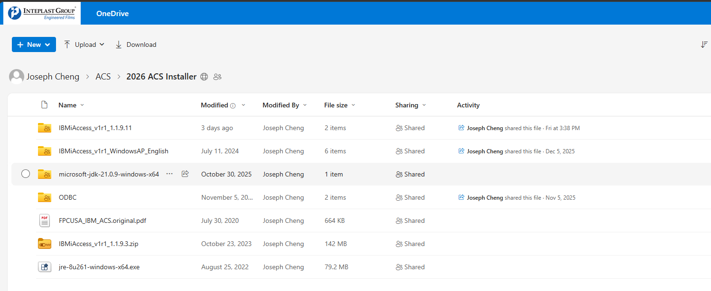
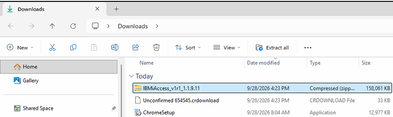
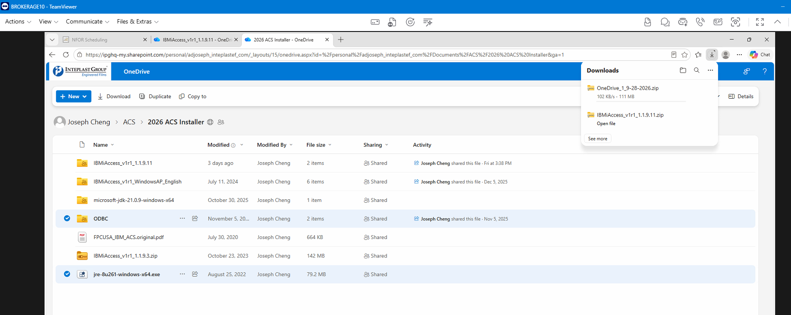
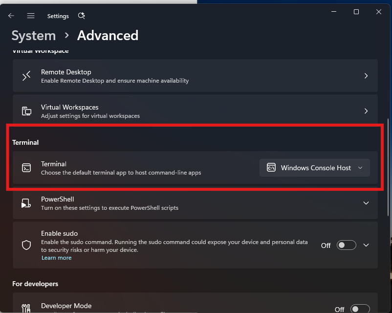
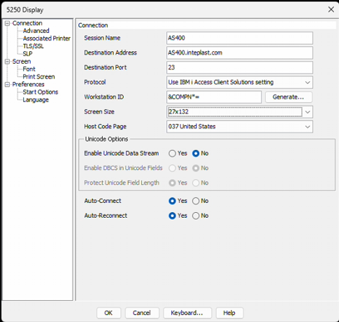
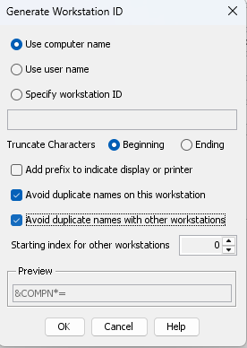
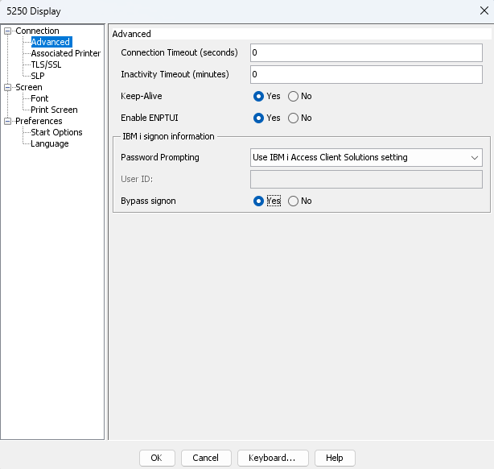
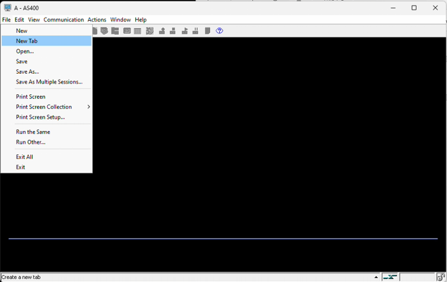

# ACS: Installation Guide

How to install IBM i Access Client Solutions (ACS) and set up the AS400 display session on a new laptop.

> **💡 Good to know:** AS400 access runs through ACS. ACS needs **Java** installed first, and the **ODBC driver** is what lets Excel workbooks pull AS400 data. Once installed, you create a display session and save it as a desktop shortcut pointed at the ACS launcher.

## Before You Start

> **ℹ️ Note:** Installation needs local admin. Retrieve the LAPS password from Intune before starting: [Retrieve Local Administrator Password (LAPS)](../../tutorial-onboard/Intern/Laptop_Retrieve_Local_Administrator_Password_LAPS.mdx).

## Step 1: Get the Installers

From the IT share, download the 2026 ACS installer package:

| Installer | File |
| --- | --- |
| Java | Java |
| ODBC | `IBMiAccess_v1r1_WindowsAP_English` |
| IBM i Access | `IBMiAccess_v1r1_1.1.9.11` |





## Step 2: Install Java

Install Java first, because ACS won't run without it. Accept the admin prompt if it appears.



## Step 3: Install ACS

1. Open `IBMiAccess_v1r1_1.1.9.11` → `Windows_Application`.
2. Run **Install ACS 64-bit, all users**.

> **ℹ️ Note:** If the terminal display looks wrong, set **Settings** → **System** → **Advanced** → **Terminal** → **Windows Console Host**. This is cosmetic only.



## Step 4: Create the Display Session

Open **ACS Session Manager** → **New Display Session**.

### Connection

| Field | Value |
| --- | --- |
| Session Name | `AS400` |
| Destination Address | `AS400.inteplast.com` |
| Destination Port | `23` |
| Protocol | Use IBM i Access Client Solutions setting |
| Workstation ID | `&COMPN*=` ([see below](#workstation-id)) |
| Screen Size | 27x132 |
| Host Code Page | 037 United States |
| Enable Unicode Data Stream | No |
| Auto-Connect | Yes |
| Auto-Reconnect | Yes |



### Workstation ID

Click **Generate…** and set:

1. **Use computer name**.
2. Tick **Avoid duplicate names on this workstation**.
3. Tick **Avoid duplicate names with other workstations**.
4. Leave **Truncate Characters** on **Beginning**, starting index `0`.
5. The preview should read `&COMPN*=`. Click **OK**.



### Connection → Advanced

1. Set all three to **Yes**: **Keep-Alive**, **Enable ENPTUI**, **Bypass signon**.
2. Leave both timeouts at `0`, and **Password Prompting** on **Use IBM i Access Client Solutions setting**.
3. Click **OK**.



## Step 5: Save the Shortcut

1. Click **File** → **Save As** → **Desktop**, file name `AS400`.
2. Right-click the shortcut → **Properties** → **Open with** → **Change**.
3. Browse to the ACS launcher and set it as the default:

   ```text
   C:\Users\Public\IBM\ClientSolutions\Start_Programs\Windows_x86-64\acslaunch_win-64.exe
   ```



**Expected result:** Double-clicking the **AS400** shortcut opens the session and reaches the sign-on screen.

## Troubleshooting

| Symptom | Fix |
| --- | --- |
| ACS won't launch | Java is missing or the wrong version. Reinstall Java first. |
| Shortcut opens Notepad or a file picker | Not associated with ACS. Redo the **Open with** step. |
| Session opens but won't connect | Network or VPN. See [Network: Can't Reach Shared Drives or AS400](../Network/network_drive_access_troubleshooot.mdx). |
| Excel can't pull AS400 data | The ODBC driver isn't installed. See [Excel: ODBC Data Source Name Not Found](./ODBC_data_source_name_not_found.mdx). |
| Installer blocked | Needs local admin. Use the LAPS password. |

## Related

- [AS400: Add TXQAC & FPCTX Sessions](./add_TXQAC_and_FPCTX.mdx)
- [Laptop: Add AS400 Shortcuts](./add_shortcuts.mdx): Data Transfer, FPCTX, TXQAC
- [Excel: ODBC Data Source Name Not Found](./ODBC_data_source_name_not_found.mdx)
- [Excel: Enable the Data Transfer Add-in](./Excel_enable_the_data_transfer_add_in.mdx)
